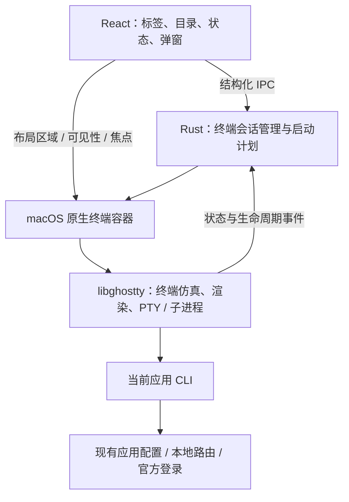

# 12 · 嵌入终端与应用标签页设计

> 状态：**macOS 首版已接入真实 Ghostty 终端**。2026-10-14。
> 基于 PHI 的 React / Tauri 2 架构，使用 Ghostty 1.2.3 原生渲染、PTY 和进程管理；要求 macOS 13+。实际实现、验证结果和尚未覆盖的发布验收见 §7.4。
> [可点击交互原型](../design/embedded-terminal-tabs.html) 使用模拟内容，不执行 CLI、不读取本机配置。
> [原型预览图](../design/embedded-terminal-tabs.png)。

## 1. 用户入口

在支持 CLI 的应用页，将现有 52px 页头扩展为“应用名称 + 固定配置标签 + 终端标签 + ＋”。点击 ＋ 先选择工作区目录和命令参数，确认后创建一个属于当前应用的终端，运行该应用 CLI，内容填满应用页的主区域。

```text
│ 应用导航 │ Claude Code  [配置] [● phi  ×] [● api  ×]  ＋    … │
│          ├───────────────────────────────────────────────────┤
│          │                                                   │
│          │                  应用 CLI                         │
│          │                原生终端内容                       │
│          │                                                   │
│          └───────────────────────────────────────────────────┤
│          │ 运行中                                      claude│
```

“配置”不可关闭，保留当前供应商、模型和连接配置；OpenClaw 的工作区 / 配置、Hermes 的记忆仍作为配置内容内的二级导航。终端不替换这些能力。顶部 ＋ 只表示“新建终端”，不恢复已移除的“添加供应商”按钮。

### 1.1 点击 ＋

1. 打开“新建终端”窗口，展示工作区目录与可选命令参数；可输入完整目录或调用系统文件夹选择器。点击“启动 CLI”才提交创建请求，取消不创建标签或进程。目录和参数格式校验失败保留表单；提交中禁止编辑、重复提交和关闭。
2. 提交成功后插入检查中的标签并激活，后端检测 CLI 可执行文件。CLI 可用时创建 Ghostty surface / PTY 并按确认的参数启动；完成后焦点进入终端，可以直接输入。
3. CLI 未安装时，标签内显示“未找到 Claude Code”，提供“安装与更新”和“重新检测”。复用现有安装设置，不自动安装、不打开空白 shell 伪装成功。
4. 启动失败保留标签和可读错误，提供重试；失败不影响其他终端。

每次有意点击可新建一个独立会话；同一次请求的 IPC 重试必须幂等，不能重复启动进程。预检取消、应用切换、窗口隐藏和异步启动完成之间使用 generation / 请求标识避免竞态。

### 1.2 工作目录

每次 ＋ 或 `⌘T` 都打开启动窗口，按以下顺序预填目录：当前终端的**启动目录** → 此应用上次成功启动目录 → 用户主目录。运行过程中 CLI 的 `cd` 或 OSC 7 上报不暗中改变这一默认值。启动目录无效时在表单中提示重新选择，不悄悄换目录。

终端内容紧接页头标签栏，不再保留目录、主题和“在其他目录新建”的独立工具条。完整启动目录保留在标签悬浮提示中；需要在其他目录新建时点击 ＋，在启动窗口内选择目录并确认，不修改当前会话。记住的目录按应用独立保存。当前终端的参数可预填到新建窗口；参数仅保留在会话内存，不写入本机持久偏好。重新启动已有会话沿用该会话上次确认的目录和参数。

目录是 CLI 的运行位置，不自动成为账本中的可信项目身份，不据此授予预算或路由权限。CLI 自身的工作区信任、登录和授权提示保留。

### 1.3 标签与页头

- 标签名默认使用目录末级名称，同目录用 `phi · 2` 区分；悬浮可见应用、完整启动目录和进程状态。终端设置的标题只作为可截断、过滤控制字符后的补充信息，不能冒充 PHI 通知或覆盖应用身份。
- 标签左侧状态点配合可读状态，不单靠颜色。仅表示启动中、运行中、已退出或失败，不从终端文本猜测“思考中”或“任务完成”。
- 配置标签和 ＋ 固定；终端标签条独立横向滚动，新建和切换时将活动标签滚入视野。大量标签可从右侧菜单选择，不撑宽窗口。
- 页头为拖动保留可命中的应用名称 / 空白区，按钮、标签及关闭区域使用 `no-drag`。窄窗口缩短标签、收起低频操作；保留原生窗口按钮的避让规则。
- 搜索、方案切换、记忆保存等现有操作只在对应配置内容中出现；终端页通过标签悬浮提示展示目录，主题入口归入页头「…」菜单。Hermes WebUI 保留在配置页及应用菜单。

### 1.3.1 终端主题菜单

终端激活时，页头「…」菜单提供「主题」子菜单，列出「跟随 PHI」及 PHI 浅色、PHI 深色、Nord、Dracula、Tokyo Night、Solarized Light 六套内置配色。每项带颜色预览和选中标记；点选立即应用，无需打开设置页、编辑 Ghostty 配置或重启 CLI。

主题统一应用于所有终端标签，并保存到本机偏好 `phi.terminal.theme`，切换应用或重开 PHI 后继续使用。「跟随 PHI」响应应用的浅色/深色外观，明确选择的配色不随应用外观变化。非法或已移除的偏好回落到「跟随 PHI」。菜单打开时保留原生终端画面，仅裁去菜单及子菜单覆盖的区域，将点击和键盘交给网页菜单；关闭后恢复完整画面与终端焦点。切换配色仅更新展示参数，不再通过卸载 / 隐藏视图刷新主题。

配色数据集中在 `src/config/terminalThemes.json`，前端用它生成预览，Rust 用它生成背景、前景、光标、选区及 16 色 ANSI 调色板。IPC 只接收已知主题 ID；原生端通过 Ghostty 配置热更新所有 surface，保留 PTY、子进程和屏幕内容。所有配色离线可用。

### 1.4 切页、关闭和退出

| 操作                            | 行为                                                                             |
| ------------------------------- | -------------------------------------------------------------------------------- |
| 切换终端 / 配置标签             | 当前终端隐藏，进程继续运行；切回恢复内容、滚动位置和焦点                         |
| 切换其他应用 / 全局页           | 各应用保留标签及选中项；侧栏应用显示运行会话数量，便于返回                       |
| 通过路由页“配置”进入应用        | 明确激活该应用的配置标签，不被上次终端选中项拦截                                 |
| CLI 中断或正常退出            | 原标签内返回可输入命令的用户 shell，保留工作目录与输出；终端会话继续运行       |
| 关闭仍在启动或运行的终端        | 启动预检阶段可直接取消；已创建进程则确认“关闭将结束此终端中的进程”，默认选择取消 |
| 关闭已退出 / 未安装 / 失败标签  | 直接移除；活动标签关闭后选择左邻终端，没有则回到配置                             |
| 关闭主窗口且设置为最小化到托盘  | 隐藏所有 native surface，保持进程；再次打开恢复                                  |
| 从菜单、Dock 或窗口真正退出 PHI | 汇总确认运行会话数量，允许取消；确认后有界清理所有终端，再执行既有网关与配置清理 |
| PHI 重启                        | 可记住目录偏好，不自动重新执行旧 CLI；首版不承诺存活进程 / 屏幕恢复              |

应用菜单中“隐藏此应用”若存在会话，应提示保留侧栏入口或先关闭会话，不能留下不可访问的终端。强制结束 PHI、系统关机等不能保证有确认弹窗；退出恢复能力需独立验收。

### 1.5 键盘和输入

macOS 应用页 `⌘T` 新建终端，`⌘W` 在终端激活时关闭当前标签并遵循确认规则，`⌘⇧[` / `⌘⇧]` 切换标签。配置标签上的 `⌘W` 遵循现有窗口关闭设置。弹窗打开时禁用标签快捷键；其余终端按键送给 CLI，包括 `Ctrl+C` 中断和 `Ctrl+D` EOF。`Ctrl+C` 只交给当前 CLI；CLI 可自行决定中断任务或退出，CLI 退出后返回同一个终端中的 shell，PHI 与其他终端保持运行，输出继续保留。在 shell 提示符下 Ctrl+C 取消当前输入；只有显式退出 shell（如 `exit` / EOF）才进入终端已退出状态，关闭标签仍遵循会话关闭流程。原生 `flagsChanged` 事件仅转发修饰键，不调用只适用于字符事件的 AppKit 字符读取接口，防止异常跨越 Tauri 边界导致整个应用中止。

复制、粘贴、文本选择、鼠标滚轮、中文输入法、候选框定位、组合字符、宽字符和 emoji 必须由原生输入桥接完整支持。粘贴遵循 Ghostty 的 bracketed paste 和危险粘贴确认，不把输入拆成按键模拟。屏幕阅读器支持需要单独验证，网页标签的 ARIA 不能替代原生终端可访问性。

`NSTextInputClient.insertText` 接收到的字符串可能由输入法复用、在回调返回后立即清空。将提交结果暂存到按键累积器时，必须先复制为不可变快照，再清理 preedit；仅保留引用会使普通字符和中文选词结果丢失，而方向键、回车仍有效。输入验收须通过 AppKit 事件队列处理 CG-backed 按键，覆盖系统拼音组合、空格选词、CLI 内输入和退出后的 shell 输入；直接调用 `insertText` 或给合成 NSEvent 填入不可变字符串不能替代这条链路。

## 2. 应用能力清单

能力清单独立于供应商模式和 `PROXY_APP_IDS`。支持供应商配置不等于支持 CLI；支持 CLI 也不等于统一网关接管。

| PHI appId        | 应用           | 新建会话启动命令 | 备注                                          |
| ---------------- | -------------- | ------------------------------ | --------------------------------------------- |
| `claude`         | Claude Code    | `claude`                       | 沿用当前 Claude 配置和登录                    |
| `codex`          | Codex          | `codex`                        | 启动交互客户端                                |
| `gemini`         | Gemini CLI     | `gemini`                       | 启动交互客户端                                |
| `grokbuild`      | Grok Build     | `grok`                         | 可执行文件名不同于 appId                      |
| `opencode`       | OpenCode       | `opencode`                     | 保留应用内供应商 / 模型选择                   |
| `openclaw`       | OpenClaw       | `openclaw tui`                 | 根命令不是聊天界面；连接现有 OpenClaw gateway |
| `hermes`         | Hermes         | `hermes`                       | 遵循现有配置目录设置                          |
| `pi`             | Pi             | `pi`                           | 保留 Pi 自身的会话和模型能力                  |
| `mcode`          | MiniMax Code   | `mcode`                        | 遵循现有 `MINIMAX_DATA_DIR` 设置              |
| `claude-desktop` | Claude Desktop | 无                             | GUI 应用，不显示终端标签和 ＋                 |

上述为适配目标，逐个固定受支持版本并验证交互启动后才标记可用；本次设计没有运行用户已安装的 CLI。OpenClaw gateway 未启动时说明依赖问题，提供现有管理入口，不自动启动后台服务或把 PHI 网关误当作 OpenClaw gateway。

首页能力检测同时返回平台支持情况。macOS 首版使用随 PHI 分发的 libghostty，不要求安装 Ghostty.app。其他平台仍保留配置页，暂不出现可点击后才报不支持的 ＋；以后补齐原生集成后启用。

“从历史会话恢复”可在后续使用同一终端宿主，但须调用各应用经过验证的 resume 适配器；本轮不将历史记录 ID 当通用启动参数。

## 3. 与供应商、路由的关系

点击 ＋ 只启动当前应用，不切换供应商、不写客户端配置、不创建共享令牌。应用读取 PHI 已管理的原生配置；采用本地路由的应用继续使用既有网关认证和连接设置。多供应商并存的应用在 CLI 中选择供应商。

正在运行的 CLI 可能缓存启动时配置，也可能在后续请求时重新读取；路由组本身也可能发生变更。因此不能承诺每个标签锁定独立的供应商或模型。配置切换后沿用现有“重开应用后生效”等适配器提示，必要时提示新建终端。终端标题不把某个供应商标为永久绑定。

终端继承当前本机用户权限，不提供多用户安全隔离。打开一个标签不会扩大现有访问权限，也不能作为应用沙箱。终端输出可能包含用户代码或凭据，默认不写 PHI 账本、数据库或诊断日志；用户主动复制或 CLI 自己保存会话是各自已有行为。

## 4. 当前代码与改造位置

| 当前文件                                        | 已有行为                                                         | 设计改造                                                                 |
| ----------------------------------------------- | ---------------------------------------------------------------- | ------------------------------------------------------------------------ |
| `src/App.tsx`                                   | `renderAppPageHeader`、应用配置视图和页内导航                    | 拆出应用工作区；全局终端 store 保持会话，导航状态与终端状态分离          |
| `src/components/shell/AppPageHeader.tsx`        | 52px 拖动页头、操作区及平台窗口按钮                              | 增加可伸缩标签槽，保留拖动与窗口按钮布局                                 |
| `src-tauri/src/commands/misc.rs`                | 工具检测 / 安装；`open_provider_terminal` 仅启动外部 Claude 终端 | 抽取 CLI 发现能力；嵌入入口使用独立的启动计划，不复制旧临时凭据脚本流程  |
| `src-tauri/src/session_manager/terminal/mod.rs` | 外部终端启动，Ghostty 使用外部进程 / AppleScript 路径            | 保留兼容；新增 embedded terminal 服务，不把 `open -a Ghostty` 当嵌入实现 |
| `src-tauri/src/session_manager/providers/`      | 分应用 resume 命令、配置目录解析                                 | 复用经校验的适配器元数据，避免前端自由拼接命令                           |
| `src-tauri/src/commands/window_chrome.rs`                | macOS NSWindow 访问与外观设置                                    | 参考原生窗口接入方式，新增独立终端容器                                   |
| `src-tauri/src/lib.rs`                          | 窗口隐藏、退出请求、macOS terminate、网关清理                    | 所有退出路径汇合终端清理，避免直接 `process::exit` 绕过释放              |

已新增 `src/components/terminal/{AppTerminalTabs,TerminalPane}.tsx`、`useTerminalWorkspace.ts`、`src/lib/api/terminal.ts`、`src-tauri/src/terminal/{mod,launch,native}.rs` 和 `src-tauri/native/terminal.{h,m}`。会话由 Rust registry 与原生 surface 持有；React 卸载只隐藏终端。

## 5. Ghostty 集成



### 5.1 原生宿主

在 Tauri 主窗口中为终端保留矩形区域，挂载 `NSView` 原生子视图；以 `ghostty_platform_macos_s.nsview` 创建 surface。React 只绘制标签、工具条和状态页，终端字符与图像由 Ghostty 渲染，不通过 Tauri 逐帧转发到 React。

libghostty 在此方案中负责 surface 的 PTY 和子进程运行，PHI 管理其生命周期，不再并行引入第二套 PTY 所有者。C API 提供 app / surface 创建销毁、尺寸与焦点、键鼠 / 输入法、剪贴板和动作回调；仍需参照 Ghostty 自己的 macOS 宿主补齐 NSView 的输入协议和主线程调度，并非只传一个 view 指针即可完成。

- 全局 Ghostty app 和各 surface 生命周期明确分层；`wakeup` 回调安排主线程 tick，不能从回调重入销毁对象。
- WebView 区域先换算到 NSView 的逻辑坐标，再按屏幕倍率设置 surface 像素尺寸及 content scale。覆盖 Retina、多屏、负坐标、全屏和窗口变化。
- 不可见终端取消焦点并隐藏原生 view、更新 occlusion；进程仍需处理 PTY 输出，不能因为 React 卸载而释放 surface。
- `NSView` 与 WebView 的层级不服从 CSS `z-index`。`TerminalPane` 收集可见浮层内容矩形并传入原生遮罩，仅移除浮层覆盖的像素区域，保留其他区域的实时输出；重叠矩形按并集处理。菜单 / 对话框打开时输入交给 WebView，弹窗背景同步变暗。工具提示只让出自身矩形，不阻塞终端输入；空 popper、已关闭或隐藏节点不计入遮挡。菜单关闭后在网页焦点回交完成时恢复原生焦点，窗口重新激活和点击终端也能恢复。自定义浮层须纳入此契约。
- 主窗口失焦、隐藏、最小化与托盘面板打开时更新焦点状态；原生 responder 的 `⌘T / ⌘W` 进入 PHI 标签命令，不能只监听 DOM 键盘事件。

### 5.2 版本与打包

当前锁定 Ghostty **v1.2.3** 源码归档 SHA-256 与 Zig **0.14.1**，部署目标 **macOS 13.0**。`scripts/build_ghostty.py` 构建当前架构或 `--arch` 指定架构；首次构建先运行该脚本。静态库包含字体和 Metal 源码，运行时经 Metal 编译；terminfo、shell 资源及许可证随 `.app` 打包。核对 arm64 / x86_64 支持、许可证及第三方声明，验证签名、公证和打包后离线启动。不能依赖用户安装的 Ghostty.app 或开发机上的源码路径。

当前公开 C API 以 Ghostty 自身宿主使用为主，按版本绑定的集成层维护，不当作稳定通用 SDK。已有 Cocoa + WKWebView 原生集成检查覆盖视图共存、文本输入与进程关闭，完整 Tauri 发布验收范围见 §7.4；WebAssembly 终端解析器不等价于完整的原生 Ghostty 渲染与 PTY 方案。

### 5.3 启动计划

后端以 `appId + cwd + arguments` 选择固定的 executable / 默认 args，将用户参数解析为独立 argv 后追加，并构造内部 `LaunchPlan { command, cwd, environment }`；不接受前端覆盖可执行程序。用户参数支持空格分隔、引号与反斜杠转义，上限 16 KiB / 256 项，拒绝 NUL 和不完整引号；不执行变量替换、命令替换、管道或重定向。复用现有登录 shell PATH / 工具发现逻辑并校验真实可执行路径，不只读取 GUI 启动进程的 PATH，也不依赖 shell alias。目录独立传递为 working directory；不存在、无权限、不可执行分别报错。

审查的 `ghostty_surface_config_s.command` 是字符串而非 argv。当前以固定的 `session.sh` 启动脚本作为会话主进程，CLI 的 executable / args 以位置参数传入并按 POSIX 单引号规则逐项编码。脚本捕获自身的 INT / QUIT，CLI 子进程仍收到默认中断信号；CLI 正常、非零或中断退出后恢复 PTY 模式，`exec` 到经校验的用户交互登录 shell。沿用同一个 PTY、启动目录及输出，不销毁 surface、不通过模拟输入启动 CLI。Ghostty 在 macOS 自行添加 `exec -l`，PHI 不在最外层重复添加 `exec`。覆盖空格、单引号、换行、中文及 `$()` 等字面字符测试，禁止拼接前端任意命令。不得用 `initial_input` 向 shell 打字来启动应用。

CLI 交还终端时需要恢复两层状态：`stty sane` 恢复内核行规程；随后清空 Kitty 增强键盘栈、关闭 modifyOtherKeys、恢复普通光标键 / 小键盘、bracketed paste、光标可见性、SGR 和同步输出状态，再启动 shell。只运行 `stty` 无法清除终端仿真器的协议状态，会出现 Ctrl+C 退出 CLI 后字符变成转义编码、不能正常输入的现象。恢复仅在 CLI 退出且输出仍连接 TTY 时执行；CLI 运行期间保留其键盘协议。不发送清屏 / RIS，也不切换缓冲区或恢复旧光标位置，避免覆盖输出和丢失滚动历史。

CLI 必须同步运行在前台，退出后再启动 shell。禁止通过非交互 shell 的 `&` 启动 CLI：它会将子进程 stdin 改成 `/dev/null` 并改变 SIGINT 处理。正常运行的 CLI 没有固定时限，也不能按推测强杀其后代进程。若启动时 stdin 已脱离终端，则从 Ghostty 已打开的可读写 PTY 输出描述符恢复；不能简单重新打开 `/dev/tty`，macOS 的 kqueue 输入读取器可能无法监听这个设备别名。shell 接管时 stdin 仍须连接实际 PTY。原生诊断只记录焦点、处理结果和文本长度，不记录按键内容或输入法文本。

已传递 Claude、Codex、OpenCode、OpenClaw、Hermes、Pi、MiniMax Code 的适配器目录环境。Gemini / Grok 的非默认配置目录尚无已验证的启动契约，当前明确报错，避免静默使用其他配置；默认目录可正常启动。继承环境、配置冲突及 PATH 处理在后端完成，不把全部环境或密钥发到 WebView。启动诊断只返回脱敏错误码和安全展示的命令名。确需临时文件时使用每会话唯一目录、最小权限及可靠清理，不沿用按 PHI PID 共用的脚本名。

### 5.4 退出与资源回收

每个 session 对应一个 surface 和明确的进程所有权。正常退出依据 Ghostty 进程退出回调 / 查询更新状态，并保留可见输出供检查；设置锁定版本支持的退出后保留策略。无可靠退出码时只写“进程已退出”，不编造成功。重启先释放旧 surface，再在原标签创建新 generation。

关闭时先请求正常结束，再在限定时间内处理该会话拥有的进程组并释放 PTY / surface；避免仅凭复用风险较高的裸 PID 向不相关进程发信号。锁定补丁限制进程组发现与等待时间，先发 SIGHUP，约一秒后升级为 SIGKILL；登录包装进程先退出时继续回收其组内子进程。原生测试已覆盖忽略 HUP 的子进程。后台脱离进程组的服务不自动承诺可回收，OpenClaw 等共享服务不归终端关闭流程所有。

取消退出确认时不得已经关停终端或网关。真正退出先停止接收新建请求，再清理终端，最后沿用现有网关 / 配置恢复流程；超时要有明确处理，不能让 PHI 无期限卡住。

## 6. 已实现的状态和接口契约

```ts
type TerminalPhase =
  | "checking"
  | "starting"
  | "running"
  | "missing-cli"
  | "failed"
  | "exited"; // 关闭期间 UI 禁用重复操作，关闭完成后移除快照

type TerminalSnapshot = {
  id: string; // 后端生成，区别于 CLI 自身会话 ID
  appId: AppId;
  generation: number; // 重启后的事件隔离
  sequence: number; // 同一 generation 内事件顺序
  title: string;
  launchCwd: string;
  launchArgs: string; // 已确认的参数，仅存于会话内存，重启沿用
  phase: TerminalPhase;
  errorCode?: string;
};
```

| 命令                    | 输入 / 输出要点                                                                                |
| ----------------------- | ---------------------------------------------------------------------------------------------- |
| `terminal_capabilities` | 各应用 CLI / 平台能力、用于启动表单的 defaultCwd；安装状态在新建时检查                                                      |
| `terminal_create`       | `{ appId, cwd, arguments?, requestId }` → 后端 session ID；同 requestId 幂等，参数按字面量 argv 传递，不执行 shell 片段 |
| `terminal_list`         | 返回此主窗口可访问的所有快照，供重连与前端初始化                                               |
| `terminal_present` | `{ id, revision, x, y, width, height, visible, focus, dark, theme, overlays?, blocked?, dimmed? }`；检查主窗口、会话归属、有限矩形和单调 revision，遮挡矩形最多 64 个，隐藏/显示、输入阻塞与布局合并提交 |
| `terminal_restart`      | 仅允许已退出或失败的 session；检查 generation，不重复启动                                      |
| `terminal_close`        | session ID / generation / confirmed；运行中未确认会被后端拒绝，预检取消后禁止迟到启动                                  |
| `terminal://changed`    | 只推送生命周期和安全显示元数据，按 generation / sequence 丢弃旧事件                            |

后端持有进程与原生句柄；前端 store 放在应用导航之上，查询失败不会清空后端会话。WebView reload 后调用 list 重新绑定；跨整应用进程重启不恢复运行态。`running` 代表终端会话存活，包含初始 CLI 和 CLI 退出后的 shell，不等于 CLI 已认证或任务执行中。

仅主窗口授权的本地前端可调用管理命令，托盘窗口不获得任意新建 / 输入权限；前端失联或 dispose 时隐藏原生 view，重连后按新 revision 恢复，避免旧 view 盖住新的页面。目录偏好可持久化；运行态、屏幕缓冲和输入历史不写入 PHI 数据库。

## 7. 实施与验收顺序

### 第一阶段：macOS 原生验证

完成一个临时隔离窗口内的 Ghostty surface：模拟 CLI / shell 输出、中文输入法、Retina resize、弹窗遮挡、失焦及关闭后进程回收。锁定库版本并验证打包产物可运行。这一阶段不修改用户供应商或启动真实付费请求。

### 第二阶段：应用标签完整流程

接入配置固定页签、多个终端、每应用状态保留、目录选择、缺少 CLI / 启动失败 / 正常退出、窗口隐藏和所有退出入口。首先验收 Claude / Codex / Gemini，再按能力清单覆盖其他六个 CLI；未验收适配器不误标已支持。

### 第三阶段：交付检查

| 类别     | 必须验证                                                                                   |
| -------- | ------------------------------------------------------------------------------------------ |
| 交互     | ＋ 一次创建一次；快速连点、IPC 重试、启动中关闭、重试与迟到事件不泄漏会话                  |
| 页面     | 切配置、其他应用、路由页再返回会话仍可用；路由“配置”按钮始终打开配置标签                   |
| 小窗口   | 900 × 600、侧栏展开 / 收起、多标签横向滚动，＋ 和窗口拖动区域保持可用                      |
| 原生视图 | 2× / 1× 显示器间拖动、resize、全屏、最小化、浮层叠加与嵌套弹窗无错位 / 穿透                |
| 输入     | 中英文 IME、选区复制、bracketed paste、宽字符、鼠标应用模式、快捷键和原生焦点              |
| 进程     | Ctrl+C、EOF、非零退出、会话重启、关闭运行标签、退出取消、退出超时及子进程回收              |
| 配置     | 打开终端不写供应商配置；自定义配置目录正确；相互切换不错误宣称供应商隔离                   |
| 安全     | 恶意目录 / 参数字面量、前端伪造 appId / session / bounds、OSC 标题与剪贴板、日志无环境密钥 |
| 分发     | arm64 / x86_64 的实际发布目标、离线、无 Ghostty.app、签名、公证及资源路径                  |

原型浏览器测试仅验证交互设计，不能替代原生终端、中文输入法或真实 CLI 验收。首版不包含分屏、终端独立窗口、远程 SSH 管理、跨重启进程恢复或按标签隔离供应商。

2026-10-14 原型验证：独立 Headless Chrome 检查 24 项交互与布局，通过多应用会话保留、配置跳转、目录新建、关闭确认、退出重启、缺少 CLI / 失败恢复、900 × 600 和 600 × 600 窗口布局；无浏览器运行错误，无外部资源请求。此结果只覆盖 HTML 原型。

### 7.4 本轮实施与实测（2026-10-14）

已接入应用页配置固定标签、终端新建/关闭、每应用选中项、目录选择、状态页、退出后保留输出与重启；安装入口复用设置页。最多保留 32 个标签。原生 surface 使用 `sessionId:generation`，后端与前端均丢弃旧代事件；关闭预检标签后不会创建进程。主窗口隐藏保留进程，轻量模式不能销毁仍有终端的窗口。退出与应用内重启先确认，再清理；WebView 开始导航时原生视图立即隐藏。

`TerminalPane` 的原生展示失败会显示重试入口，重试布局不重启进程。路由/设置中的应用配置跳转激活固定配置标签。供应商配置不因打开终端而改写；终端输出与完整环境不经 IPC 或 PHI 持久化。

已执行：

- SDK 固定源码构建成功，禁用 Sentry；新增依赖许可证收集脚本和 CI 构建/资源传递步骤。
- Tauri release 构建与独立目录 `.app` 打包成功，已核对最低系统版本 13.0、terminfo 和依赖许可证（108 个资源文件）；本机 ad-hoc 签名通过严格校验。使用包内资源再次运行原生测试，22 项断言通过。产物位于 `tmp/phi-terminal-package/release/bundle/macos/PHI.app`，没有替换正在运行的旧实例。
- `scripts/ghostty/test_native.py` 的 22 项原生断言通过：真实 shell/PTY、ANSI 和宽字符、中文 preedit/提交、原生 ⌘T、WKWebView 同级视图命中、双会话切换、隐藏释放焦点、resize、非零退出和忽略 HUP 的子进程回收。截图输出到 `tmp/phi-terminal-native.png`。
- 前端工作区 8 项 + App 集成 19 项，共 27 项通过；覆盖会话保留、旧事件、关闭竞态、目录、能力清单、浮层隐藏和展示失败重试。
- 后端终端相关 12 项通过（其中新增启动能力与命令字面量 2 项，其余为外部终端回归）。类型检查、渲染端构建和 release 原生编译通过。
- 实际 React 标签/面板在隔离浏览器下通过 9 项检查：900×600、9 个终端横向溢出、＋ 可用、应用切换保留、配置返回与关闭确认。API 使用合成数据，不替代原生输入验证。

尚需发布环境验收：真实九种 CLI 版本/登录流程、系统输入法候选窗口、跨屏缩放与全屏、完整 Tauri Dock/系统退出交互、Intel 运行、签名/公证及无开发目录机器上的离线安装。此次没有启动付费 AI 请求，没有覆盖当前运行的 PHI 实例。Gemini / Grok 的自定义目录暂不支持，默认目录不受影响。Windows / Linux 保留既有功能，暂不显示嵌入终端入口。

## 8. 参考

- [Ghostty：libghostty 说明](https://ghostty.org/docs/about#libghostty)。
- [Ghostty C API](https://github.com/ghostty-org/ghostty/blob/v1.2.3/include/ghostty.h)：审查了 macOS platform、surface config、input、process 和 runtime callback 接口；实现绑定 v1.2.3。
- [Ghostty macOS 宿主](https://github.com/ghostty-org/ghostty/tree/v1.2.3/macos)：原生视图、输入法和生命周期的参考实现。
- [OpenClaw TUI CLI](https://docs.openclaw.ai/cli/tui)：`openclaw tui` 的交互入口及 gateway 依赖。
- PHI 当前源码位置见第 4 节；[桌面端设计](08-品牌迁移与桌面端设计.md)、[适配层设计](04-Agent配置适配层设计.md)、[凭据与安全](07-凭据与安全设计.md) 继续约束此功能。
